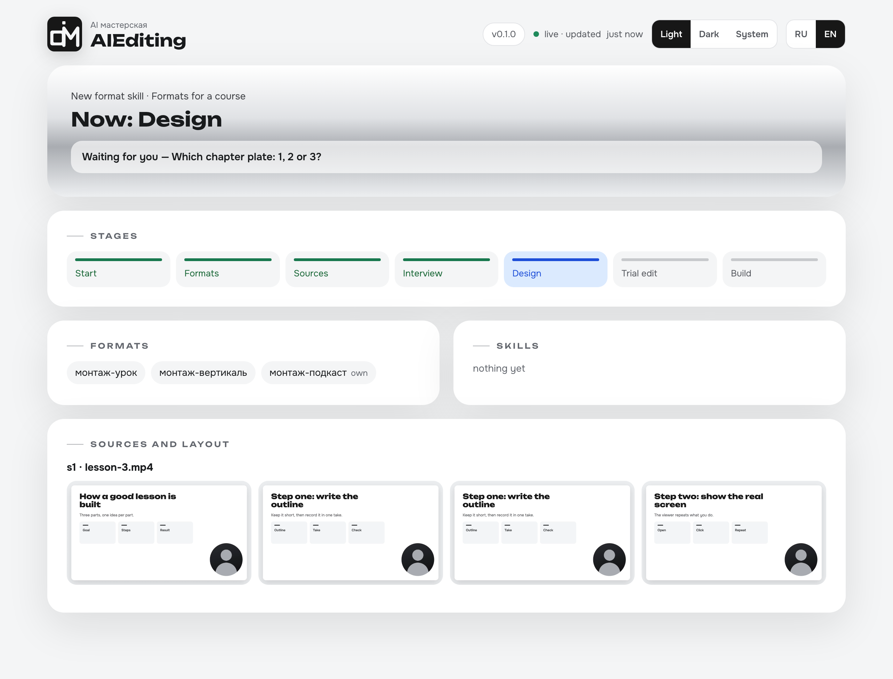
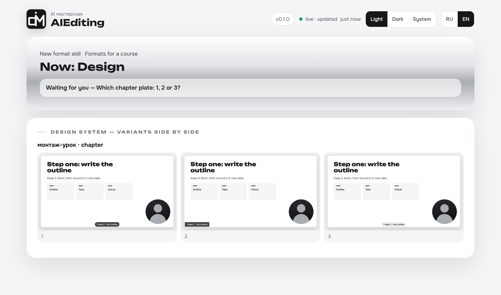
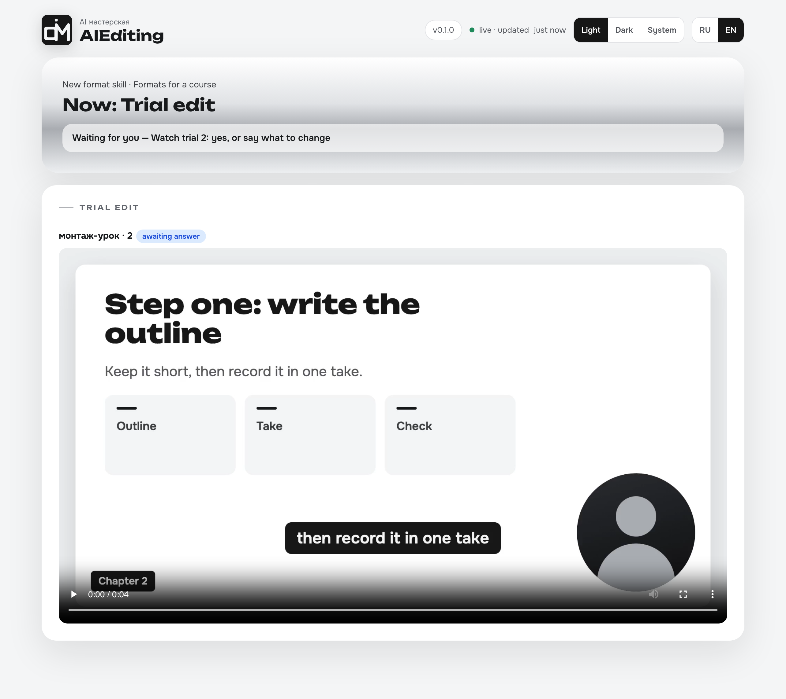

<p align="center">
  <picture>
    <source media="(prefers-color-scheme: dark)" srcset="assets/aiediting-logo-dark.png">
    <source media="(prefers-color-scheme: light)" srcset="assets/aiediting-logo-light.png">
    
  </picture>
</p>

<p align="center">
  <a href="https://skills.sh/alexfisenkov/AIEditing"></a>
</p>

<p align="center"><strong>Show it once how you edit — your agent edits that way from then on.</strong></p>

<p align="center"><b>English</b> · <a href="README.ru.md">Русский</a></p>

A workshop that builds **your own video-editing skills** for AI agents. You go through an interview
once — which formats you shoot (stream, lesson, vertical or your own), how each should be cut, what the
captions and chapter plates look like — watch a trial edit on **your** footage, say what you don't like
until it is right, and get a format skill named after your word, such as `монтаж-урок` ("lesson
edit"). After that, in any folder, you just say "edit this like a lesson".

> Status: early version (0.1).

<p align="center">
  <a href="assets/aiediting-dashboard.png"></a>
  <a href="assets/aiediting-dashboard.png"></a>
  <a href="assets/aiediting-dashboard.png"></a>
</p>

<p align="center"><sub>Stages · design variants · a trial edit, on demo data — <a href="assets/aiediting-dashboard.png">open the full dashboard</a></sub></p>

**And you can always see what's going on.** The dashboard opens beside the chat by itself and runs on your own computer: the current stage and what it is waiting for, frames of your footage, design variants side by side, trial clips with your verdicts, the skills already built. Two themes, Russian and English.

---

## Installation

### If you'd rather not open a terminal

Open your AI agent — Claude Code, Cursor, Codex — and paste this:

```
Install the AIEditing skill for me. Run in the terminal:

npx skills add alexfisenkov/AIEditing --skill aiediting -g -y -a <put yourself here: claude-code, cursor, codex>

If npx is not found, give me a link to download Node.js and wait.
Don't install anything else.
When you're done, tell me in one line that it's ready and that the session needs a restart.
```

The agent does the rest. Then restart it — skills are loaded at startup.

### From the terminal

```bash
npx skills add alexfisenkov/AIEditing -g
```

The installer asks for which agents to install — just confirm.

<details>
<summary>One-line install, no questions</summary>

```bash
npx skills add alexfisenkov/AIEditing --skill aiediting -a claude-code -g -y
```

| Flag | What it does |
|------|--------------|
| `--skill aiediting` | Installs only AIEditing |
| `-a claude-code` | Installs for Claude Code |
| `-g` | Globally — the workshop and every format skill it builds work in any folder |
| `-y` | Don't ask questions |

</details>

**Requires:** [Node.js](https://nodejs.org) 22.20+ (for `npx`), Python 3.9+ and ffmpeg in `PATH`. Everything else is installed later, only if your formats need it, and only after you say yes.

| System | State |
|---|---|
| macOS | supported, checked in CI |
| Windows | supported, checked in CI; whisper.cpp is installed by hand |
| Linux | not tested |

CI runs the unit tests and installs the pinned Python packages. Rendering of animated inserts and graphics is checked by hand and only on macOS. Editing by markers needs a timeline exported from Final Cut, which runs only on a Mac.

---

## How to use it

1. Type `/aiediting`. A dashboard opens beside the chat (or in your browser): stages, your answers,
   frames of your footage, design variants side by side, trial clips.
2. Choose: **a new format skill** or **refine** one you already have.
3. New: pick formats from the list and add your own through commas («урок, вертикаль, подкаст»). Give
   1–3 source videos. Answer the questions in rounds of 3–4 — each with a recommended option and an
   example on your video. Pick the design: your own style or the Chrome & Graphite example.
4. Watch the trial edit. «Нет» → say what is wrong, show how it should and should not be, what to add or
   remove and where — the workshop reworks it until you say «да».
5. The skill `монтаж-<your word>` is built and installed globally. In a new session, anywhere:
   «смонтируй ~/Videos/lesson.mp4» or «смонтируй как урок».

The list offers six formats, under these words; anything else you name becomes your own format:

| In the list | What it does |
|---|---|
| эфир (stream) | barely touches it: blur over secrets, loudness, `.srt` beside the video |
| урок (lesson) | cuts pauses and "uh", chapter plates, `.srt` beside the video |
| youtube | an episode, with chapters |
| вертикаль (vertical) | 9:16, speech without pauses, burned-in captions, export for three platforms, clips up to 60 s from a long recording |
| наложения (overlays) | the speech stays whole, without a single cut; graphics and real screens on top |
| ютуб (YouTube with graphics) | clean speech from your takes, graphics and real screens on top, remarks by Final Cut markers |

For a lesson (and any format that shows a screen) you can choose **animated inserts**: where you list
files, steps or points, or name a number, a short animation in your design system plays beside the
screen, in the corner opposite your face, at most once every 30–60 s (`params.animations.every`, 45 by default).

- You approve the moments, the template («файлы», «шаги», «список», «число») and the text before anything is rendered. An empty answer means no animations.
- The price: Node.js 22+ and HyperFrames with its own browser on disk (≈400 MB together) and about 5 seconds of rendering per insert.
- They are installed by `ae.py doctor --install node --yes` and `--install hyperframes --yes`, only for a format that chose inserts, after your yes.
- HyperFrames comes from a checked lockfile (`npm ci --ignore-scripts`) into `~/.aiediting/node` (Windows: `%LOCALAPPDATA%\AIEditing\node`). Its telemetry is off, and its project history is written into the issue's work folder and goes with it.

**Without questions.** Say «без вопросов» in your first message and give a recording:

```
/aiediting новый формат «обращение», без склеек, в нашем стиле, без вопросов, вот запись
```

The workshop takes what it can find out — the
design system you mentioned, real screens of what you named, the output folder of your other skills — and decides the
rest itself. You get the finished video, the installed skill, and one list: what it decided, what it installed, what it
opened and what it could not know. The limits do not change: nothing is published, generated or paid for, your speech
goes to no outside service unless you named one, and no key is asked for. The format then keeps running without
questions until a refinement turns that off.

**Graphics over the video.** For anyone talking to the camera in 16:9: the model reads the whole speech and writes
scenes on the words, with real screens and materials you named; the speaker's frame moves between layouts. The speech
stays as it is, and with cuts the scenes go on the finished video. Scenes are checked by contact sheets, a search for
empty stretches and a sound check against the base video. The price is Node.js 22+, Remotion with its browser in the working folder
(≈700 MB; see its licence below), and rendering about as long as the video.

**YouTube with graphics.** The speech is assembled from your best takes at the speed you set, graphics go on top. You mark
remarks with Final Cut markers: cuts land on the finished video and the scenes keep their places. So far this format has
been proven on one real video.

A format skill puts the result into `<your issues folder>/<date-topic>/`: the video, a `.srt` when the
format makes one, and a short report. A remark after watching goes into that report, and the skill
suggests running AIEditing to refine the format.

---

## What it does and what it never does

| Does | Never does |
|---|---|
| interviews you and builds a format skill from your answers, or takes one message if you ask for no questions | publishes, uploads or sends anything |
| edits **one trial piece** of your source to show you; without questions, the whole recording | voices, generates video, music or images |
| installs only the tools your formats need, by pinned versions, after your yes (asking for no questions is that yes, and each is named at the end) | asks for a key or prints one |
| keeps the previous version of a skill and restores it in one command | puts into a skill anything you did not choose |

---

## Speech recognition — what is best where

| Provider | Cost | Privacy | Word boundaries | Best for |
|---|---|---|---|---|
| Local whisper (whisper.cpp) | free | the recording stays on your computer | good for captions; short words and "uh" are sometimes lost, and when cutting inside speech it can clip a word or invent one in silence, so listen to the joins | private recordings, no budget |
| ElevenLabs Scribe | paid | the recording goes to ElevenLabs | the most precise | lessons where every pause and "uh" is cut |
| Any OpenAI-compatible service (OpenAI, OpenRouter, your own server) | depends | goes to the address you set | depends on the model | when you already pay for one |
| Your own command | yours | yours | yours | anything else |

Changing the provider is one answer in the interview or a refinement.

---

## Tools and licences

The catalog (`skills/aiediting/catalog/tools.json`) holds tools with open licences, plus Remotion, whose licence is not
open and is named below. Each has an exact version or a tested minimum: ffmpeg, whisper.cpp, Tesseract and Node.js come from your
package manager at its current version, at least the minimum. AIEditing installs them only when chosen.

| Tool | What for | Licence | Weight |
|---|---|---|---|
| ffmpeg | cutting, joining, loudness, blur, export | LGPL-2.1+ (GPL-2.0+ for GPL builds) | light |
| whisper.cpp + model | local speech recognition | MIT | the model is ≈3 GB (large-v3) |
| Pillow, numpy, OpenCV | plates and captions as images, face and layout | MIT-CMU, BSD-3-Clause, Apache-2.0 | light |
| YuNet model | finding the face for layouts, verticals and graphics | MIT | light |
| Tesseract | text on frames when looking for secrets (Apple Vision on macOS) | Apache-2.0 | light |
| Node.js 22+ + HyperFrames 0.8.201 | animated inserts in a lesson: files, steps, a list, a number — only when chosen | MIT, Apache-2.0 | Node ≈100 MB; HyperFrames with its own Chrome ≈300 MB |
| Remotion 4.0.513 | graphics over the video — only when chosen; from the kit's lockfile into the working folder | Remotion License | ≈700 MB per working folder, with its browser |
| Remotion + RobustVideoMatting | effects "behind the head" in a vertical — **not yet**: not offered, not installed | Remotion License, GPL-3.0 | heavy |

Python packages are pinned by Python version; Python 3.9 is the minimum. On 3.12 and newer — Pillow 13.0.0,
numpy 2.5.4; on 3.10–3.11 — Pillow 12.3.0, numpy 2.2.6; on 3.9 — Pillow 11.3.0, numpy 2.0.2; OpenCV
4.14.0.94 everywhere. CI installs the sets for Python 3.12 and 3.14 on macOS and Windows and the set for 3.9 on Windows;
the set for 3.10–3.11 is not run in CI.

> **Remotion is not open source.** It is free for individuals and companies of up to three people;
> larger companies need a paid licence. Check the terms at remotion.pro before choosing graphics over the video.
> Nothing is installed by default. Effects "behind the head" are not built yet, so the workshop does not offer them.

[OpenMontage](https://github.com/calesthio/OpenMontage) (AGPL-3.0) is a full production pipeline from
script to generation; AIEditing does not include it — only this link.

---

## Keys

Keys live only in your environment or in a `.env` file (see `.env.example`); AIEditing reads them
by variable name and never prints them. Never paste a key into the chat.

The key already lies in another place — say, the `.env` of another tool? Give that file's path as
`asr.key_file` in the interview (`~` works). The key is read from it at every run and copied nowhere:
not into the profile, the format skill, the report or the log. Lookup order: the environment, then
`key_file` if it is set (and only it: no file or no variable in it is an error naming both);
without `key_file` — `.env` in the working folder, then `~/.aiediting/.env`
(Windows: `%LOCALAPPDATA%\AIEditing\.env`).

---

## Updating and removing

```bash
npx skills update aiediting -g      # or just tell your agent: «обнови AIEditing»
npx skills remove aiediting -g
```

Start a new session after updating. Format skills built by AIEditing are separate folders with their
own copy of the editing runtime: updating or removing AIEditing does not touch them. A refinement
rebuilds a skill on the current version and keeps the previous one in
`~/.agents/skills/.aiediting-backups/`; the workshop brings it back on request.

If you installed animated inserts: the Node packages live in `~/.aiediting/node` (Windows:
`%LOCALAPPDATA%\AIEditing\node`) and the render browser in `~/.cache/hyperframes/chrome` (≈200 MB). The
browser is shared with other HyperFrames installs and is not removed with the `node` folder: delete that
folder yourself if nothing else needs it.

---

## What's in the repository

```
skills/aiediting/        the skill itself (what gets installed)
├── SKILL.md             the workshop's order and rules
├── phases/  prompts/    one file per stage, read when the stage starts
├── tools/ae.py          one command per event: dashboard, profiles, build, install, doctor
├── tools/state/         the dashboard page, state and local server
├── templates/           the format-skill template and starting profiles
├── catalog/             formats, steps, tools with licences and pins
├── runtime/             editing mechanics copied into every format skill
├── overlay-kit/         graphics over the video: scenes, the camera, cuts by markers
├── schema/  design/     profile schema, example design system
assets/                  the logo and dashboard screenshots for this page
tests/                   python3 -m unittest discover -s tests -v
.github/workflows/       CI on macOS and Windows, monthly install check
```

---

## Development

```bash
python3 -m unittest discover -s tests -v
```

Tests make their own synthetic media with ffmpeg, install skills only into a temporary home folder and
never use the network.

---

## License

[MIT](LICENSE) © Alexander Fisenkov — you may use, modify and distribute it, including in commercial projects. The
dashboard and its server are adapted from [AISpa](https://github.com/alexfisenkov/aispa); the MIT notices are kept in
`skills/aiediting/tools/state/NOTICE.md`.
