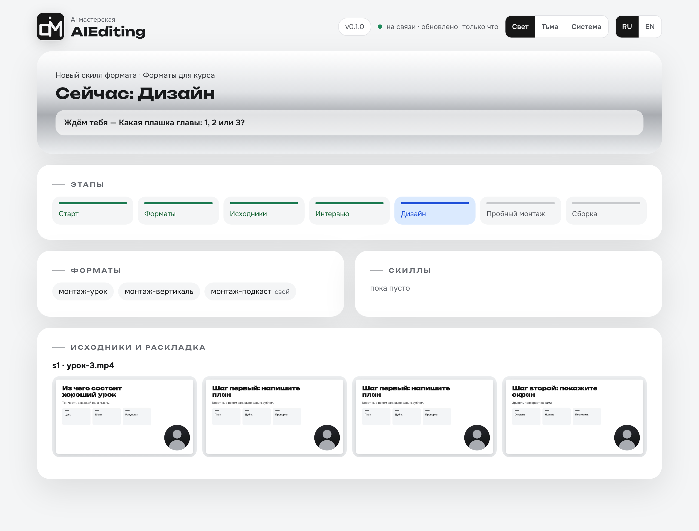
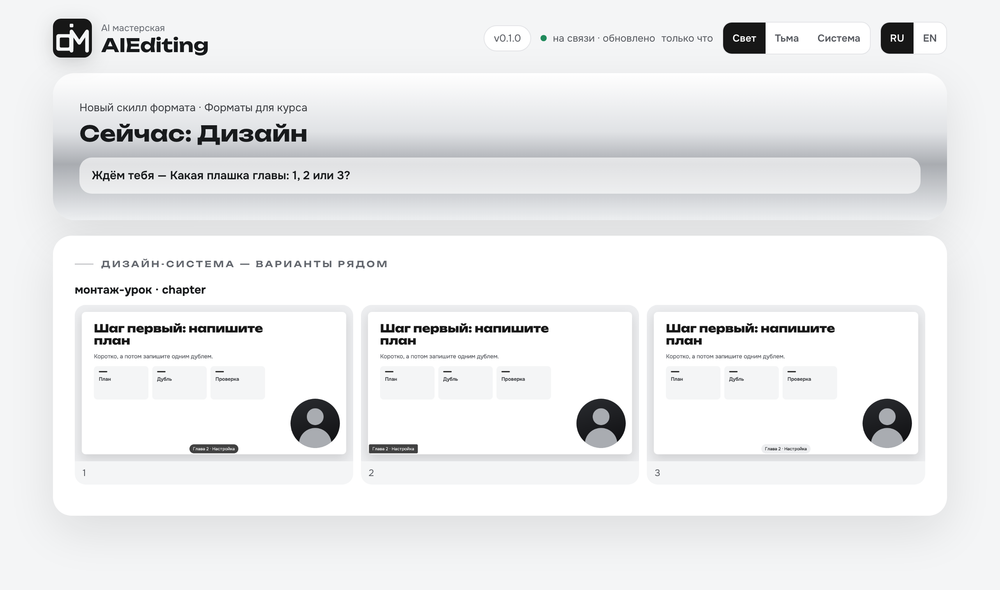
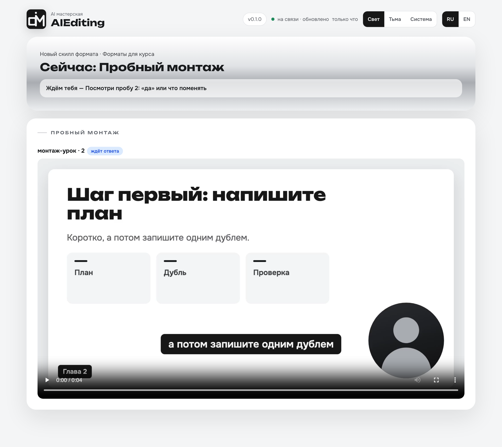

<p align="center">
  <picture>
    <source media="(prefers-color-scheme: dark)" srcset="assets/aiediting-logo-dark.png">
    <source media="(prefers-color-scheme: light)" srcset="assets/aiediting-logo-light.png">
    
  </picture>
</p>

<p align="center"><strong>Покажи один раз, как ты монтируешь, — дальше агент монтирует так сам.</strong></p>

<p align="center"><a href="README.md">English</a> · <b>Русский</b></p>

Мастерская, которая собирает **ваши собственные скиллы монтажа** для ИИ-агентов. Один раз проходите
интервью — какие у вас форматы (эфир, урок, вертикаль или свой), как их монтировать, как выглядят
субтитры и плашки глав, — смотрите пробный монтаж на **своём** исходнике, говорите, что не нравится,
пока не станет как надо, и получаете скилл с вашим словом в имени, вроде `монтаж-урок`. Дальше в любой
папке достаточно сказать «смонтируй как урок».

> Состояние: ранняя версия (0.1).

<p align="center">
  <a href="assets/ru/aiediting-dashboard.png"></a>
  <a href="assets/ru/aiediting-dashboard.png"></a>
  <a href="assets/ru/aiediting-dashboard.png"></a>
</p>

<p align="center"><sub>Этапы · варианты оформления · пробный монтаж, на демо-данных — <a href="assets/ru/aiediting-dashboard.png">открыть дашборд целиком</a></sub></p>

**И всегда видно, что происходит.** Дашборд сам открывается рядом с чатом и работает на вашем компьютере: текущий этап и чего он ждёт, кадры исходников, варианты оформления рядом, пробные ролики с вашими решениями, уже собранные скиллы. Две темы, русский и английский.

---

## Установка

### Если не хотите открывать терминал

Откройте своего ИИ-агента — Claude Code, Cursor, Codex — и вставьте:

```
Поставь мне скилл AIEditing. Выполни в терминале:

npx skills add alexfisenkov/AIEditing --skill aiediting -g -y -a <подставь себя: claude-code, cursor, codex>

Если npx не найден, дай ссылку на скачивание Node.js и подожди.
Больше ничего не ставь.
Когда закончишь, скажи одной строкой, что готово и что нужно перезапустить сессию.
```

Дальше агент всё сделает сам. Потом перезапустите его: скиллы загружаются при старте.

### Из терминала

```bash
npx skills add alexfisenkov/AIEditing -g
```

Установщик спросит, для каких агентов ставить, — просто подтвердите.

<details>
<summary>Установка одной строкой, без вопросов</summary>

```bash
npx skills add alexfisenkov/AIEditing --skill aiediting -a claude-code -g -y
```

| Флаг | Что делает |
|------|------------|
| `--skill aiediting` | Ставит только AIEditing |
| `-a claude-code` | Ставит для Claude Code |
| `-g` | Глобально: мастерская и все собранные ею скиллы форматов работают в любой папке |
| `-y` | Не задавать вопросов |

</details>

**Нужно:** [Node.js](https://nodejs.org) 22.20+ (для `npx`), Python 3.9+ и ffmpeg в `PATH`. Остальное ставится позже, только если оно нужно вашим форматам, и только после вашего «да».

| Система | Состояние |
|---|---|
| macOS | поддерживается, проверяется в CI |
| Windows | поддерживается, проверяется в CI; whisper.cpp ставится вручную |
| Linux | не проверено |

CI гоняет юнит-тесты и ставит закреплённые Python-пакеты. Рендер анимированных вставок и графики проверяется вручную и только на macOS. Для правок маркерами нужна выгрузка таймлайна из Final Cut, а он работает только на Mac.

---

## Как пользоваться

1. Наберите `/aiediting`. Рядом с чатом (или в браузере) откроется дашборд: этапы, ваши ответы, кадры
   исходников, варианты оформления рядом, пробные ролики.
2. Выберите: **новый скилл формата** или **доработать** существующий.
3. Новый: выберите форматы из списка и добавьте свои через запятую («урок, вертикаль, подкаст»). Дайте
   1–3 исходника. Отвечайте на вопросы раундами по 3–4 — у каждого рекомендация и пример на вашем видео.
   Выберите оформление: свой стиль или пример Chrome & Graphite.
4. Посмотрите пробный монтаж. «Нет» → скажите, что не так, покажите, как надо и как не надо, что
   добавить или убрать и где, — мастерская переделывает, пока вы не скажете «да».
5. Скилл `монтаж-<ваше слово>` собирается и ставится глобально. В новой сессии, в любой папке:
   «смонтируй ~/Видео/урок.mp4» или «смонтируй как урок».

В списке шесть форматов, вот под какими словами; всё остальное, что вы назовёте, станет вашим форматом:

| В списке | Что делает |
|---|---|
| эфир | почти не трогает: блюр секретного, громкость, `.srt` рядом |
| урок | вырезает паузы и «э-э», главы плашками, `.srt` рядом |
| youtube | выпуск с главами |
| вертикаль | 9:16, речь без пауз, вшитые субтитры, выгрузка под три площадки, из длинной записи клипы до 60 с |
| наложения | речь целиком, без единой склейки; поверх графика и настоящие экраны |
| ютуб (YouTube с графикой) | чистая речь из дублей, поверх графика и настоящие экраны, замечания маркерами Final Cut |

Для урока (и любого формата, где на экране что-то показывают) можно выбрать **анимированные вставки**:
где вы перечисляете файлы, шаги, пункты или называете число, рядом с экраном коротко проигрывается
анимация в вашей дизайн-системе, в углу напротив лица, не чаще раза в 30–60 с (`params.animations.every`, по умолчанию 45).

- Моменты, шаблон («файлы», «шаги», «список», «число») и текст вы утверждаете до рендера. Пустой ответ — без анимаций.
- Цена: Node.js 22+ и HyperFrames со своим браузером на диске (≈400 МБ вместе) и около 5 секунд рендера на вставку.
- Ставятся они `ae.py doctor --install node --yes` и `--install hyperframes --yes`, только формату, где вставки выбраны, после вашего «да».
- HyperFrames ставится по проверенному lock-файлу (`npm ci --ignore-scripts`) в `~/.aiediting/node` (Windows — `%LOCALAPPDATA%\AIEditing\node`). Телеметрия выключена, история проектов HyperFrames пишется в рабочую папку выпуска и удаляется вместе с ней.

**Без вопросов.** Скажите «без вопросов» в первом сообщении и дайте запись:

```
/aiediting новый формат «обращение», без склеек, в нашем стиле, без вопросов, вот запись
```

Мастерская берёт всё, что может узнать сама: упомянутую дизайн-систему,
настоящие экраны того, что вы назвали, папку выпусков других ваших скиллов — а остальное решает сама. Вы получаете готовый
ролик, установленный скилл и один список: что решено, что поставлено, что открывалось и чего узнать не удалось. Границы те же:
ничего не публикуется, не генерируется и не оплачивается, речь не уходит во внешний сервис, если вы его не назвали, ключей не
просит. Дальше формат работает без вопросов, пока доработка это не выключит.

**Графика поверх видео.** Для того, кто говорит в камеру, кадр 16:9: модель читает всю речь и пишет сцены по словам, с
настоящими экранами и материалами, которые вы назвали; рамка спикера переезжает между раскладками. Речь остаётся как есть,
а при нарезке сцены ложатся на готовое видео. Сцены проверяются листами кадров, поиском пустот и сверкой звука с базовым
видео. Цена: Node.js 22+, Remotion с его браузером в рабочей папке (≈700 МБ; про лицензию ниже) и рендер примерно на длину ролика.

**YouTube с графикой.** Речь собирается из лучших дублей на заданной скорости, поверх идёт графика. Замечания вы ставите
маркерами Final Cut: вырезки ложатся на готовое видео, а сцены остаются на своих местах. Пока формат проверен на одном
настоящем ролике.

Скилл формата кладёт результат в `<папка выпусков>/<дата-тема>/`: ролик, `.srt`, если формат его делает,
и короткий отчёт. Замечание после просмотра записывается в этот отчёт, и скилл предлагает запустить
AIEditing, чтобы доработать формат.

---

## Что делает и чего не делает никогда

| Делает | Не делает никогда |
|---|---|
| опрашивает вас и собирает скилл формата по ответам, а если просите без вопросов — по одному сообщению | не публикует, не загружает и никуда не отправляет |
| монтирует **один пробный кусок** вашего исходника, чтобы показать; без вопросов — всю запись | не озвучивает, не генерирует видео, музыку и картинки |
| ставит только нужные вашим форматам инструменты, по закреплённым версиям, после вашего «да» (просьба без вопросов и есть это «да», каждый инструмент назван в конце) | не просит ключей и не печатает их |
| хранит прежнюю версию скилла и возвращает её одной командой | не кладёт в скилл того, чего вы не выбирали |

---

## Распознавание речи — что где лучше

| Поставщик | Цена | Приватность | Границы слов | Лучше всего |
|---|---|---|---|---|
| Локальный whisper (whisper.cpp) | бесплатно | запись не покидает компьютер | хороши для субтитров; короткие слова и «э-э» иногда теряются, а при резке внутри речи он может срезать слово или выдумать его в тишине, так что стыки надо слушать | личные записи, без бюджета |
| ElevenLabs Scribe | платно | запись уходит в ElevenLabs | самые точные | уроки, где режется каждая пауза и «э-э» |
| Любой OpenAI-совместимый сервис (OpenAI, OpenRouter, свой сервер) | по-разному | уходит по адресу, который вы указали | зависит от модели | когда уже за что-то платите |
| Своя команда | как у неё | как у неё | как у неё | всё остальное |

Сменить поставщика — один ответ в интервью или в доработке.

---

## Инструменты и лицензии

В каталоге (`skills/aiediting/catalog/tools.json`) инструменты с открытой лицензией и Remotion, чья лицензия не открытая,
о нём ниже. У каждого точная версия или проверенный минимум: ffmpeg, whisper.cpp, Tesseract и Node.js приходят из менеджера
пакетов в его текущей версии, не ниже минимума. AIEditing ставит их только если они выбраны.

| Инструмент | Для чего | Лицензия | Вес |
|---|---|---|---|
| ffmpeg | резка, склейка, громкость, блюр, выгрузка | LGPL-2.1+ (GPL-2.0+ в GPL-сборках) | лёгкий |
| whisper.cpp + модель | локальное распознавание речи | MIT | модель ≈3 ГБ (large-v3) |
| Pillow, numpy, OpenCV | плашки и субтитры картинками, лицо и раскладка | MIT-CMU, BSD-3-Clause, Apache-2.0 | лёгкие |
| Модель YuNet | поиск лица для раскладок, вертикалей и графики | MIT | лёгкая |
| Tesseract | текст на кадрах при поиске секретного (на macOS — Apple Vision) | Apache-2.0 | лёгкий |
| Node.js 22+ + HyperFrames 0.8.201 | анимированные вставки урока: файлы, шаги, список, число — только если выбраны | MIT, Apache-2.0 | Node ≈100 МБ; HyperFrames со своим Chrome ≈300 МБ |
| Remotion 4.0.513 | графика поверх видео — только если выбрана; из lock-файла комплекта в рабочую папку | Remotion License | ≈700 МБ на рабочую папку, вместе с браузером |
| Remotion + RobustVideoMatting | эффекты «за головой» в вертикали — **пока нет**: не предлагаются и не ставятся | Remotion License, GPL-3.0 | тяжёлые |

Версии Python-пакетов закреплены по версии Python; минимум — Python 3.9. На 3.12 и новее — Pillow 13.0.0,
numpy 2.5.4; на 3.10–3.11 — Pillow 12.3.0, numpy 2.2.6; на 3.9 — Pillow 11.3.0, numpy 2.0.2; OpenCV
4.14.0.94 везде. CI ставит наборы для Python 3.12 и 3.14 на macOS и Windows и набор для 3.9 на Windows;
набор для 3.10–3.11 в CI не запускается.

> **Remotion — не открытая лицензия.** Бесплатно для частных лиц и компаний до трёх человек; компаниям
> больше — платная лицензия. Проверьте условия на remotion.pro, прежде чем выбирать графику поверх видео.
> По умолчанию ничего не ставится. Эффектов «за головой» пока нет, и мастерская их не предлагает.

[OpenMontage](https://github.com/calesthio/OpenMontage) (AGPL-3.0) — полный продакшн от сценария до
генерации; в AIEditing не входит — только эта ссылка.

---

## Ключи

Ключи живут только в окружении или в файле `.env` (образец — `.env.example`); AIEditing читает их
по имени переменной и нигде не печатает. Ключ в чат не присылайте.

Ключ уже лежит в другом месте — например, в `.env` другого инструмента? Назовите путь к этому файлу
на опросе — это `asr.key_file` (`~` можно). Ключ читается оттуда при каждом запуске и никуда не
копируется: ни в профиль, ни в скилл формата, ни в отчёт, ни в журнал. Порядок поиска: окружение,
потом `key_file`, если он задан (и только он: нет файла или переменной в нём — ошибка с путём и
именем переменной); без `key_file` — `.env` в рабочей папке, потом `~/.aiediting/.env`
(Windows: `%LOCALAPPDATA%\AIEditing\.env`).

---

## Обновление и удаление

```bash
npx skills update aiediting -g      # или просто скажите агенту: «обнови AIEditing»
npx skills remove aiediting -g
```

После обновления начните новую сессию. Скиллы форматов, собранные AIEditing, лежат в своих папках со
своей копией механики монтажа: обновление или удаление AIEditing их не трогает. Доработка пересобирает
скилл на текущей версии, а прежнюю кладёт в `~/.agents/skills/.aiediting-backups/`; мастерская вернёт её
по просьбе.

Если ставили анимированные вставки: пакеты Node лежат в `~/.aiediting/node` (Windows —
`%LOCALAPPDATA%\AIEditing\node`), а браузер рендера — в `~/.cache/hyperframes/chrome` (≈200 МБ). Браузер
общий с другими установками HyperFrames и вместе с папкой `node` не удаляется: если он больше никому не
нужен, удалите эту папку сами.

---

## Что в репозитории

```
skills/aiediting/        сам скилл (то, что ставится)
├── SKILL.md             порядок и правила мастерской
├── phases/  prompts/    по файлу на этап, читаются, когда этап начался
├── tools/ae.py          одна команда на событие: дашборд, профили, сборка, установка, проверка окружения
├── tools/state/         страница дашборда, состояние и локальный сервер
├── templates/           шаблон скилла формата и стартовые профили
├── catalog/             форматы, шаги, инструменты с лицензиями и пинами
├── runtime/             механика монтажа, копируется в каждый скилл формата
├── overlay-kit/         графика поверх видео: сцены, камера, вырезки по маркерам
├── schema/  design/     схема профиля, пример дизайн-системы
assets/                  логотип и снимки дашборда для этой страницы
tests/                   python3 -m unittest discover -s tests -v
.github/workflows/       CI на macOS и Windows, ежемесячная проверка установки
```

---

## Разработка

```bash
python3 -m unittest discover -s tests -v
```

Тесты сами делают синтетические ролики ffmpeg-ом, ставят скиллы только во временную домашнюю папку и не
ходят в сеть.

---

## Лицензия

[MIT](LICENSE) © Александр Фисенков — можно использовать, менять и распространять, в том числе в коммерческих проектах.
Дашборд и его сервер переработаны из [AISpa](https://github.com/alexfisenkov/aispa); уведомления MIT сохранены в
`skills/aiediting/tools/state/NOTICE.md`.
